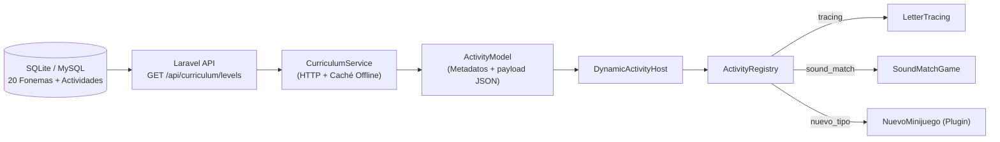

# Arquitectura del Motor de Contenido Dinámico — LeoPárvulos

**Fase 16:** Motor de Contenido Dinámico (Backend Laravel + Cliente Flutter)  
**Fecha:** 17 de Noviembre de 2026  

---

## 1. Visión General

El Motor de Contenido Dinámico desacopla el currículo pedagógico (fonemas, palabras, instrucciones, trazos y distractores) del código compilado de la aplicación móvil. Esto permite añadir letras, ajustar ejercicios o introducir **nuevos tipos de minijuegos** respetando el **Principio Abierto/Cerrado (SOLID — Open/Closed Principle)**: abierto a extensión, cerrado a modificación del núcleo.



---

## 2. Contrato de Datos (`GET /api/curriculum/levels`)

El endpoint es público, de solo lectura, libre de PII (verificado por `php artisan pii:scan`) y cacheable (`Cache-Control: public, max-age=300, must-revalidate`).

### Estructura de Respuesta
```json
{
  "version": "1.0",
  "total_phonemes": 20,
  "levels": [
    {
      "id": 8,
      "code": "phoneme_s",
      "title": "Fonema /s/ - Sol",
      "phoneme": "/s/",
      "letter": "s",
      "example_word": "Sol",
      "unit": 2,
      "order_index": 8,
      "audio_key": "fonemas/fonema_s",
      "activities": [
        {
          "id": 15,
          "activity_code": "act_s_tracing",
          "type": "tracing",
          "title": "Traza la letra S",
          "instruction": "¡Hola! Traza la letra S con tu dedito.",
          "audio_key": "fonemas/fonema_s",
          "order_index": 1,
          "payload": {
            "letter": "s",
            "phoneme": "/s/",
            "example_word": "Sol",
            "audio_key": "fonemas/fonema_s",
            "instruction_audio": "instrucciones/instruccion_traza_letra_s",
            "success_text": "¡Excelente! Has trazado la letra S. ¡Sss como en Sol!",
            "checkpoints": [
              {"x": 0.64, "y": 0.30},
              {"x": 0.50, "y": 0.50}
            ]
          }
        },
        {
          "id": 16,
          "activity_code": "act_s_sound_match",
          "type": "sound_match",
          "title": "Encuentra el sonido /s/",
          "instruction": "Toca el dibujo que empieza con /s/.",
          "audio_key": "fonemas/fonema_s",
          "order_index": 2,
          "payload": {
            "target_letter": "S",
            "target_phoneme": "/s/",
            "audio_key": "fonemas/fonema_s",
            "options": [
              {
                "name": "Sol",
                "image_key": "palabras/s_sol",
                "emoji": "🌞",
                "is_correct": true,
                "feedback_text": "¡Sol! Empieza con /s/.",
                "audio_key": "palabras/sol"
              }
            ]
          }
        }
      ]
    }
  ]
}
```

### Currículo Sembrado (`CurriculumSeeder`)
El seeder idempotente `database/seeders/CurriculumSeeder.php` puebla los **20 fonemas esenciales** organizados en 4 unidades progresivas (40 actividades en total: 20 de trazado + 20 de emparejamiento fonema-imagen):

- **Unidad 1 (Vocales):** `a`, `e`, `i`, `o`, `u`
- **Unidad 2 (Consonantes Iniciales):** `m`, `p`, `s`, `l`, `t`
- **Unidad 3 (Consonantes Intermedias):** `n`, `d`, `f`, `r`, `b`
- **Unidad 4 (Consonantes Avanzadas):** `c`, `g`, `j`, `v`, `ñ`

---

## 3. Cómo Añadir un Nuevo Tipo de Minijuego sin Tocar el Núcleo de la App

Gracias a `ActivityModel.payload` (mapa JSON abierto) y a `ActivityRegistry`, incorporar un nuevo minijuego (por ejemplo, `memory_pairs` o `syllable_flashcard`) **no requiere modificar** `CurriculumService`, `ActivityModel`, `DynamicActivityHost`, las migraciones ni las rutas de navegación principales.

### Paso 1: Definir el Payload del Nuevo Tipo (opcional, tipado seguro)
Crea una clase de payload propia junto a tu nuevo widget (p. ej. `client/lib/widgets/memory_pairs_game.dart`):

```dart
class MemoryPairsPayload {
  final List<String> words;

  const MemoryPairsPayload({required this.words});

  factory MemoryPairsPayload.fromActivity(ActivityModel activity) {
    final raw = (activity.payload['words'] as List?) ?? const [];
    return MemoryPairsPayload(words: raw.cast<String>());
  }
}
```

### Paso 2: Crear el Widget con Factory `.fromActivity`
Implementa tu widget de minijuego aceptando `ActivityModel`, `TtsService?` y `VoidCallback? onComplete`:

```dart
class MemoryPairsGame extends StatelessWidget {
  final MemoryPairsPayload data;
  final TtsService? ttsService;
  final VoidCallback? onComplete;

  const MemoryPairsGame({
    super.key,
    required this.data,
    this.ttsService,
    this.onComplete,
  });

  factory MemoryPairsGame.fromActivity(
    ActivityModel activity, {
    TtsService? ttsService,
    VoidCallback? onComplete,
  }) =>
      MemoryPairsGame(
        data: MemoryPairsPayload.fromActivity(activity),
        ttsService: ttsService,
        onComplete: onComplete,
      );

  @override
  Widget build(BuildContext context) {
    // UI del nuevo minijuego...
  }
}
```

### Paso 3: Registrar el Tipo en `ActivityRegistry`
En el punto de composición / arranque de módulos (sin editar `DynamicActivityHost` ni `ActivityModel`):

```dart
final registry = ActivityRegistry.withDefaults()
  ..register(
    'memory_pairs',
    (context, activity, {ttsService, onComplete}) =>
        MemoryPairsGame.fromActivity(
          activity,
          ttsService: ttsService,
          onComplete: onComplete,
        ),
  );
```

### Paso 4: Publicar Actividades desde el Backend (Sin Migraciones)
Inserta nuevas filas en `curriculum_activities` con `type = 'memory_pairs'` y su JSON correspondiente en `payload` (por ejemplo, añadiendo un nuevo Seeder o desde el panel docente):

```php
CurriculumActivity::updateOrCreate(
    ['activity_code' => 'act_s_memory_pairs'],
    [
        'curriculum_level_id' => $levelS->id,
        'type' => 'memory_pairs',
        'title' => 'Memoria de la S',
        'instruction' => 'Encuentra las parejas con /s/.',
        'audio_key' => 'fonemas/fonema_s',
        'order_index' => 3,
        'payload' => ['words' => ['Sol', 'Sapo', 'Silla']],
    ]
);
```

### Degradación Elegante (Versiones Antiguas)
Si el backend publica un `type` que una versión anterior de la app aún no ha registrado en `ActivityRegistry`, `DynamicActivityHost` renderiza automáticamente `_UnsupportedActivityFallback` en lugar de lanzar una excepción, manteniendo la estabilidad para el usuario infantil.

---

## 4. Archivos Clave y Verificación

| Capa | Archivo | Responsabilidad |
| :--- | :--- | :--- |
| **Backend DB** | `database/migrations/2026_11_17_000001_create_curriculum_levels_table.php` | Esquema de niveles fonéticos |
| **Backend DB** | `database/migrations/2026_11_17_000002_create_curriculum_activities_table.php` | Esquema extensible de actividades con `payload` JSON |
| **Backend Seeder** | `database/seeders/CurriculumSeeder.php` | Inserta los 20 fonemas y 40 actividades de forma idempotente |
| **Backend API** | `app/Http/Controllers/Api/CurriculumController.php` | Sirve `GET /api/curriculum/levels` sin consultas N+1 |
| **Flutter Modelo** | `client/lib/content/activity_model.dart` | `ActivityModel`, `TracingPayload`, `SoundMatchPayload`, `CurriculumLevelModel` |
| **Flutter Registro** | `client/lib/content/activity_registry.dart` | `ActivityRegistry` y `DynamicActivityHost` (Open/Closed) |
| **Flutter Red** | `client/lib/content/curriculum_service.dart` | Consumo HTTP de `/api/curriculum/levels` con caché offline |
| **Minijuegos** | `client/lib/widgets/letter_tracing.dart`, `sound_match_game.dart` | Refactorizados para operar 100% por parámetros desde `ActivityModel` |
| **Tests** | `tests/Feature/CurriculumTest.php`, `client/test/content/content_engine_test.dart` | Validación determinista de seeder, endpoint, parseo y renderizado dinámico |
