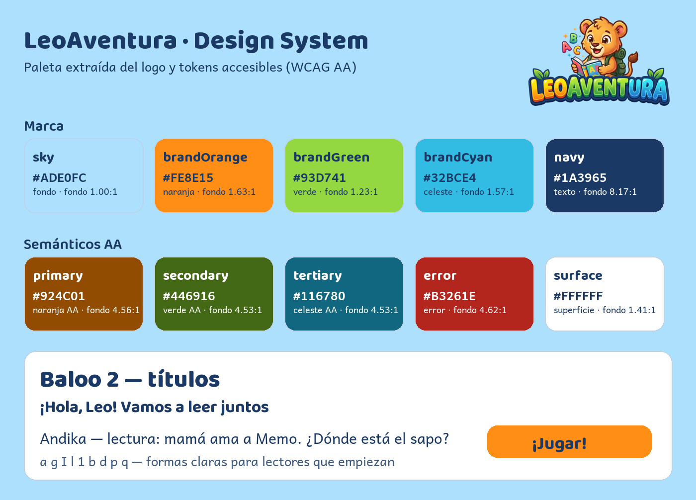
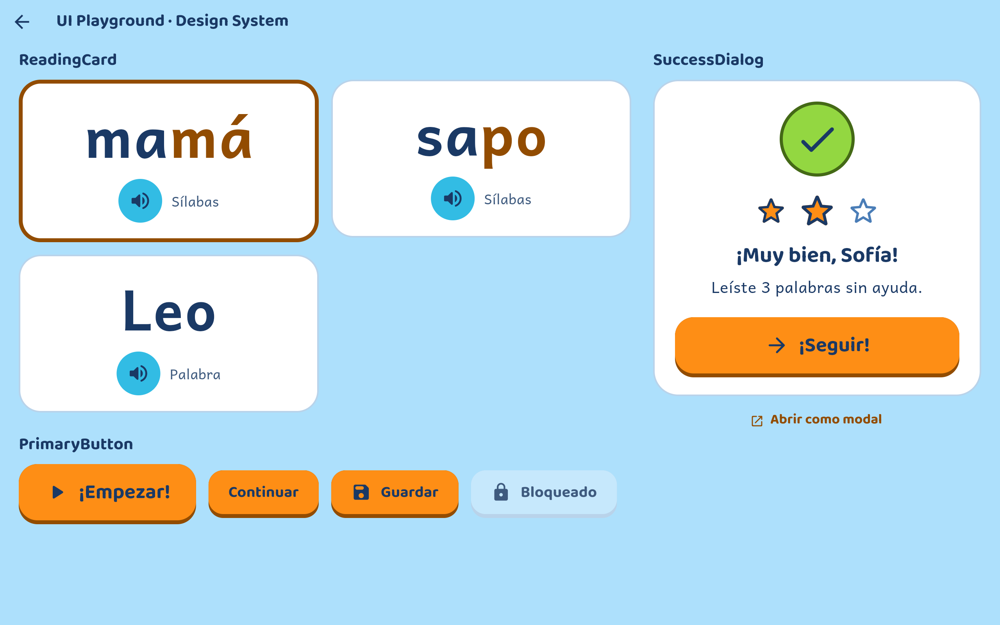

# Design System — LeoAventura

Código: `client/lib/theme/app_theme.dart` (`AppColors`, `AppContrast`, `AppTypography`, `AppTheme`).
Tests: `client/test/theme/app_theme_test.dart` (11 tests).



## 1. Logo

| Archivo | Uso |
|---|---|
| `docs/design/brand/leoaventura_logo.png` | Master sin fondo, 1467×947, PNG con transparencia |
| `client/assets/brand/leoaventura_logo.png` | Versión para la app, 1024 px de ancho |

Original: `Logo.jpg`, 2400×1792, fondo celeste. El fondo se quitó con
`scripts/remove_logo_background.py`, que hace lo siguiente:
- flood fill desde los bordes, para conservar los azules internos del logo: letras "URA", libro y destellos;
- alfa suave en el contorno según la distancia de color;
- limpieza del halo celeste en el antialiasing;
- recorte al contenido con un margen de 24 px.

```bash
python -I scripts/remove_logo_background.py Logo.jpg salida.png [--max-width 1024]
```

## 2. Paleta

### 2.1 Colores de marca (extraídos del logo)

Cada color es la **mediana de los píxeles de una región** del logo sin fondo, filtrada
por tono, saturación y brillo. No se usó un cuentagotas puntual porque las letras
tienen degradados.

| Token | HEX | Rol | Región del logo |
|---|---|---|---|
| `AppColors.sky` | `#ADE0FC` | Azul fondo → fondo de la app | Borde del JPG (desviación < 2) |
| `AppColors.brandOrange` | `#FE8E15` | Naranja primario (marca) | Letras "LEO" |
| `AppColors.brandGreen` | `#93D741` | Verde secundario (marca) | Letras "AVENT" |
| `AppColors.navy` | `#1A3965` | Azul marino → texto | Contorno del logotipo |
| `AppColors.brandCyan` | `#32BCE4` | Celeste (acento) | Letras "URA" |

### 2.2 Por qué hay dos capas de color

Los tonos vivos de la marca **no alcanzan WCAG AA** sobre el fondo celeste ni con texto
blanco encima:

| Color de marca | Sobre `sky` | Texto blanco encima | Texto `navy` encima |
|---|---|---|---|
| `brandOrange` `#FE8E15` | 1.63:1 ❌ | 2.31:1 ❌ | **5.00:1 ✅** |
| `brandGreen` `#93D741` | 1.23:1 ❌ | 1.74:1 ❌ | **6.62:1 ✅** |
| `brandCyan` `#32BCE4` | 1.57:1 ❌ | 2.22:1 ❌ | **5.20:1 ✅** |

Regla de uso:

- **Colores de marca vivos** → **rellenos** de superficies grandes (botones, tarjetas de
  actividad, insignias, ilustraciones), **siempre con texto `navy`** encima.
- **Colores semánticos** (abajo) → **texto, iconos, bordes y enlaces** sobre el fondo o
  sobre blanco. Son los mismos tonos, oscurecidos (bajando la luminosidad HSL y
  conservando el tono) hasta cumplir 4.5:1 sobre `sky` **y** con texto blanco encima.

### 2.3 Colores semánticos (`ColorScheme`)

| Rol M3 | Token | HEX | Sobre `sky` | Sobre blanco | Texto encima |
|---|---|---|---|---|---|
| `primary` | `AppColors.primary` | `#924C01` | **4.56:1** | 6.45:1 | blanco 6.45:1 |
| `primaryContainer` | `brandOrange` | `#FE8E15` | — | — | navy 5.00:1 |
| `secondary` | `AppColors.secondary` | `#446916` | 4.53:1 | 6.41:1 | blanco 6.41:1 |
| `secondaryContainer` | `brandGreen` | `#93D741` | — | — | navy 6.62:1 |
| `tertiary` | `AppColors.tertiary` | `#116780` | 4.53:1 | 6.41:1 | blanco 6.41:1 |
| `tertiaryContainer` | `brandCyan` | `#32BCE4` | — | — | navy 5.20:1 |
| `error` | `AppColors.error` | `#B3261E` | 4.62:1 | 6.54:1 | blanco 6.54:1 |
| `errorContainer` | `AppColors.errorContainer` | `#F9DEDC` | — | — | `#410E0B` |
| `surface` | `AppColors.surface` | `#FFFFFF` | — | — | navy 11.56:1 |
| `onSurface` (texto) | `AppColors.text` = `navy` | `#1A3965` | 8.17:1 | 11.56:1 | — |
| `onSurfaceVariant` | `AppColors.textMuted` | `#3E5A7E` | ≥ 4.5 | ≥ 6.4 | — |
| `outline` | `AppColors.outline` | `#4A7DB7` | 3.02:1 | 4.28:1 | (bordes, ≥ 3:1) |
| `outlineVariant` | `AppColors.outlineVariant` | `#B9D3EA` | — | — | decorativo |
| fondo (scaffold) | `AppColors.background` = `sky` | `#ADE0FC` | — | — | navy 8.17:1 |

Contenedores de superficie: tintes de `sky` (`#F3FAFF` → `#C6E8FC`). `surfaceTint`
es transparente, para que las superficies elevadas no se tiñan de naranja.

Sin tema oscuro por ahora.

## 3. Tipografía

| Familia | Uso | Pesos empaquetados | Por qué |
|---|---|---|---|
| **Baloo 2** | `display*`, `headline*`, `title*`, `labelLarge` (botones) | 400, 500, 600, 700, 800 | Redondeada y amigable; combina con el logotipo |
| **Andika** | `body*`, `labelMedium/Small`, palabras de lectura | 400, 700 (+ itálicas) | Diseñada por SIL para lectores principiantes: "a" y "g" de un solo piso, y diferencia clara entre I/l/1 y b/d/p/q |

Escala (tamaños más grandes que Material 3 para párvulos):

| Estilo | Familia | Tamaño | Peso |
|---|---|---|---|
| displayLarge / Medium / Small | Baloo 2 | 57 / 45 / 36 | 800 / 800 / 700 |
| headlineLarge / Medium / Small | Baloo 2 | 32 / 28 / 24 | 700 |
| titleLarge / Medium / Small | Baloo 2 | 22 / 18 / 16 | 700 / 600 / 600 |
| labelLarge (botones) | Baloo 2 | 18 | 700 |
| bodyLarge / Medium / Small | Andika | **20 / 18 / 16**, interlineado 1.5 | 400 |
| labelMedium / Small | Andika | 16 / 14 | 700 |
| `AppTypography.readingWord()` | Andika | 40, espaciado 1.5 | 700 |

Todos los estilos usan `navy` como color.

### Fuentes empaquetadas (offline-first)

`google_fonts` **no descarga nada**: `AppTheme.configureFonts()` (llamado en `main()`)
fija `GoogleFonts.config.allowRuntimeFetching = false` y registra las licencias OFL en
`LicenseRegistry`. Los archivos están en `client/assets/google_fonts/`, con los nombres
que `google_fonts` espera (`Baloo2-Bold.ttf`, `Andika-Regular.ttf`, ...).

- Fuente: repositorio oficial `google/fonts` (`ofl/baloo2`, `ofl/andika`). Licencia SIL OFL 1.1 (`OFL-*.txt`).
- Baloo 2 solo se publica como fuente variable (`wght` 400–800). Las 5 instancias
  estáticas se generaron con `fontTools.varLib.instancer`.
- Las 9 fuentes se recortaron a latín: Basic, Latin-1 (incluye `ñ ¿ ¡ á é í ó ú ü`),
  Latin Extended-A, comillas tipográficas, guiones, `…` y `€`. Se conservaron todas las
  características OpenType. Tamaño total: 4.4 MB → **760 KB**. Se descartó la tabla
  Graphite `Silt` de Andika, que Flutter no usa.
- Para agregar un peso o un carácter (por ejemplo, otro idioma), hay que regenerar el
  archivo desde el original con el mismo recorte.

En los tests, la familia de un estilo aparece como `Baloo2_700` o `Andika_regular`
(formato `<Familia>_<variante>` de `google_fonts`).

## 4. Componentes (en `AppTheme.light()`)

| Componente | Estilo |
|---|---|
| `FilledButton` (acción principal) | Fondo `brandOrange`, texto `navy` (5.0:1), Baloo 2 18/700, alto mínimo 56, radio 20 |
| `OutlinedButton` | Borde `navy` de 2 px, texto `navy` |
| `TextButton` | Texto `primary` (4.56:1 sobre `sky`, 6.45:1 sobre blanco) |
| `IconButton` | Mínimo 48×48 dp |
| `AppBar` | Fondo `sky`, texto e iconos `navy`, sin elevación |
| `Card` | Blanca, sin sombra, borde `outlineVariant`, radio 20 |
| `SnackBar` | Fondo `navy`, texto blanco |

Todos los objetivos táctiles miden ≥ 48 dp.

## 5. Verificación (`client/test/theme/app_theme_test.dart`)

| Test | Comprueba |
|---|---|
| headlineLarge | Un `Text` con `headlineLarge` se pinta con `Baloo2_700`, color `#1A3965` y tamaño 32, y la fuente carga desde assets |
| body | El texto por defecto usa `Andika_regular`, en navy y tamaño 18 |
| escala | display/headline/title → Baloo 2; body/label → Andika (solo pesos 400 y 700) |
| empaquetado | Los 9 TTF y las 2 licencias están en el `AssetManifest`, y todos los estilos cargan sin red |
| `AppColors` | Constantes de marca = colores extraídos del logo |
| `ColorScheme` | primary, secondary, error y surface semánticos; scaffold = `sky` |
| **contraste primary** | `AppContrast.ratio(AppColors.primary, AppColors.background)` ≥ 4.5 (**4.56:1**) |
| contraste marca | Documenta que `brandOrange` sobre `sky` < 3:1 (la razón de tener `primary`) |
| matriz AA | 19 parejas texto/fondo del esquema ≥ 4.5:1; `outline` ≥ 3:1 sobre blanco y sobre `sky` |
| referencia | `AppContrast` da 21:1 para negro/blanco y 4.48:1 para `#777` sobre blanco (valores WCAG) |
| botón | `FilledButton` ≥ 48 dp, texto navy, y pasa `androidTapTargetGuideline` y `textContrastGuideline` |

El contraste se calcula con `Color.computeLuminance()` de Flutter (fórmula WCAG 2.x),
sin paquetes externos.

## 6. Componentes base (`client/lib/ui/`)

Captura: [`docs/ui/design_system_components.png`](../ui/design_system_components.png)
(tablet horizontal, 1280×800 a 2x) y `design_system_components_portrait.png` (800×1280).
Pantalla de prueba: **UI Playground** (`/#/playground`, `lib/screens/ui_playground_screen.dart`).



Los componentes usan **solo** tokens de `app_theme.dart` (`AppColors`, `AppTypography`,
`Theme.of(context).textTheme`). Un test recorre el código fuente de `lib/ui/` y del
playground, y falla si encuentra `Color(0x…)`, `Colors.*`, `Color.from…`, `fontFamily`,
`GoogleFonts.*` o `TextStyle(` nuevos.

### `PrimaryButton`

```dart
PrimaryButton(label: '¡Empezar!', icon: Icons.play_arrow_rounded,
    size: PrimaryButtonSize.large, onPressed: () {});
```

| Propiedad | Detalle |
|---|---|
| Colores | Cara `brandOrange`, texto e icono `navy` (5.0:1), canto inferior `primary` |
| Tipografía | `labelLarge` (Baloo 2 700): 20 dp en `regular`, 26 dp en `large` |
| Tamaño | `regular` 56 dp y `large` 72 dp de alto, más 5 dp de canto; ancho mínimo = 2× el alto |
| Estados | Al presionar se hunde 5 dp. `isLoading` muestra un spinner y bloquea los toques. `onPressed: null` lo deshabilita: fondo `surfaceContainerHighest`, texto `textMuted` (5.5:1). |
| Overflow | Etiqueta de una línea con elipsis; `expand: true` ocupa todo el ancho |

### `ReadingCard`

```dart
ReadingCard(word: 'mamá', syllables: ['ma', 'má'], caption: 'Sílabas',
    onListen: () => audio.play('palabras/palabra_mama'), onTap: ..., selected: true);
```

| Propiedad | Detalle |
|---|---|
| Palabra | `AppTypography.readingWord`: Andika Bold, **72 dp**, espaciado 1.5 |
| Sílabas | Alternan `navy` y `primary` (11.6:1 y 6.45:1 sobre blanco) |
| Selección | Borde de 5 dp en `primary` (6.45:1; `brandOrange` daría solo 2.3:1 como indicador de estado) |
| Escuchar | `IconButton` de 56 dp, `brandCyan` con icono `navy` (5.2:1), tooltip "Escuchar *palabra*" |
| Semántica | Un solo nodo: "mamá, sílabas: ma - má", con `button` y `selected` cuando tiene `onTap` |
| Overflow | `FittedBox(scaleDown)`: una palabra que no cabe se reduce en vez de desbordarse. El layout del playground da ≥ 360 dp por tarjeta para que en tablet **no** haga falta reducirla (lo verifica un test). |

### `SuccessDialog`

```dart
await SuccessDialog.show(context, title: '¡Lo lograste!', message: '...', stars: 2);
```

| Propiedad | Detalle |
|---|---|
| Insignia | Círculo `brandGreen` con borde `secondary` y check `navy` |
| Estrellas | Ganadas: `brandOrange` con contorno `navy`, como el logo (el contorno da ≥ 3:1). No ganadas: contorno `outline` (4.3:1). Semántica: "2 de 3 estrellas". |
| Texto | Título `headlineMedium` (Baloo 2); mensaje `bodyLarge` (Andika 20) |
| Acción | `PrimaryButton` grande "¡Seguir!" que cierra el modal |
| Modal | `barrierDismissible: false`, velo `navy` al 55 %, ancho máximo 440 dp |

### Legibilidad de la lectura a distancia de tablet

Métricas reales de Andika Bold: altura x = 0.508 em, mayúsculas = 0.725 em.
Con la palabra a 72 dp (1 dp ≈ 0.159 mm, densidad nominal de Android):

| Distancia | Altura x | Ángulo visual | Mayúscula | Ángulo visual |
|---|---|---|---|---|
| 40 cm | 5.8 mm | 50′ (10× el umbral 20/20 de 5′) | 8.3 mm | 71′ |
| 60 cm | 5.8 mm | 33′ (6.7×) | 8.3 mm | 48′ |

Es decir, a la distancia habitual de una tablet en la mesa, la letra más pequeña de la
palabra (la "a" o la "m") subtiende entre 7 y 10 veces el mínimo que distingue una
persona con visión normal. Los milímetros reales varían un poco según la densidad de
cada pantalla.

### Verificación (`client/test/ui/components_test.dart`, 10 tests)

- Uso exclusivo de tokens: revisión del código fuente.
- Playground en **tablet horizontal 1280×800, tablet vertical 800×1280 y teléfono
  412×915**: sin overflow ni errores de layout, los 3 componentes presentes y las guías
  `androidTapTargetGuideline` (48 dp), `iOSTapTargetGuideline`, `labeledTapTargetGuideline`
  y `textContrastGuideline` sin hallazgos. Se auditan primero en el tamaño real y después
  con la página entera visible.
- En tablet, las 3 palabras se pintan en Andika 700 a 72 dp, **sin reducción** (el
  tamaño pintado es igual al natural).
- `ReadingCard`: colores de sílaba y semántica. Una palabra larga en una tarjeta de
  180 dp se reduce sin desbordarse.
- `PrimaryButton`: tap, `isLoading` y deshabilitado. Etiqueta Baloo 2 `navy` sobre `brandOrange`.
- `SuccessDialog.show`: abre, anuncia "3 de 3 estrellas" y "¡Seguir!" lo cierra.

## 7. Pendiente

- Las pantallas existentes (`home_screen`, `parent_settings_screen`, el panel de padres,
  `letter_tracing`...) todavía tienen colores fijos en el código (`0xFFBF360C`, etc.).
  Heredan tipografía y botones del tema, pero hay que migrarlas a `AppColors` y
  `Theme.of(context)`.
- Tema oscuro.
